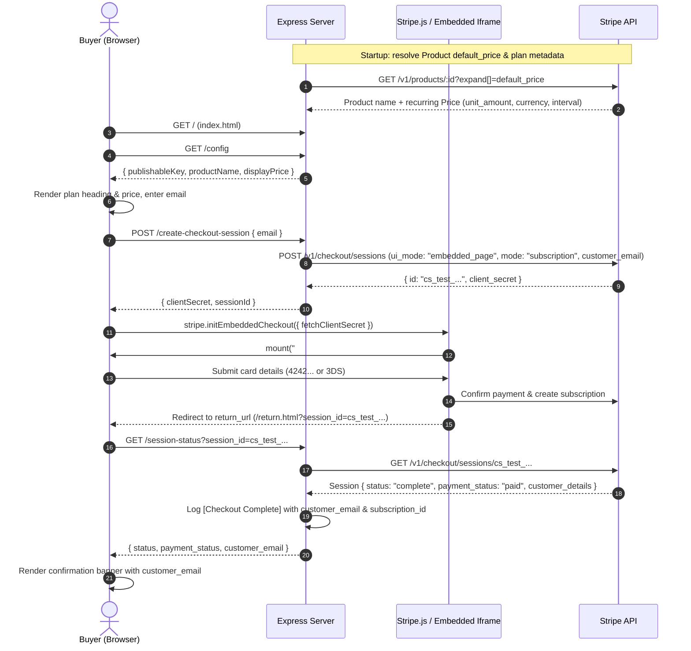
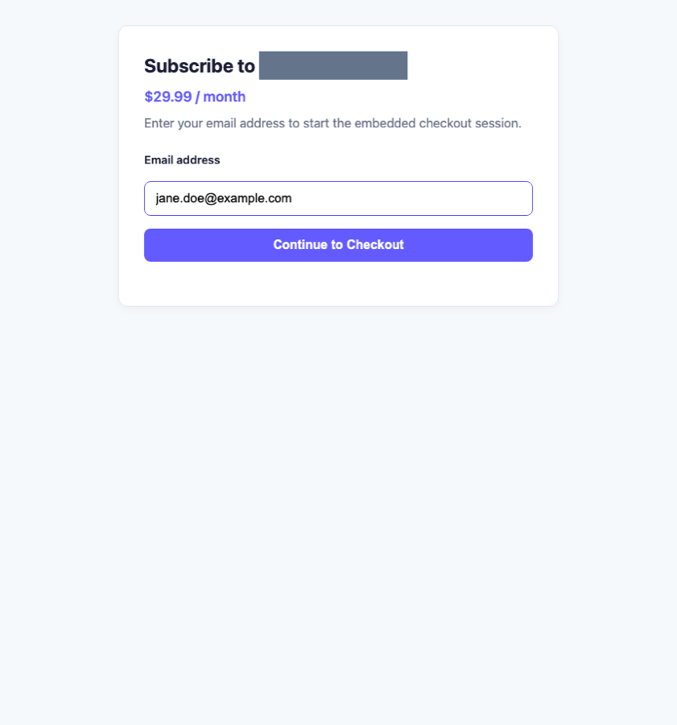
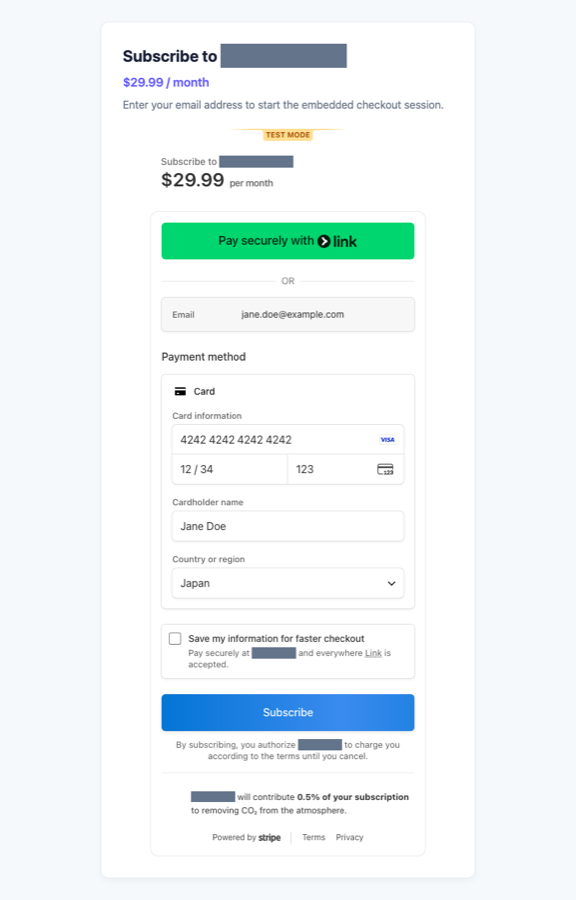
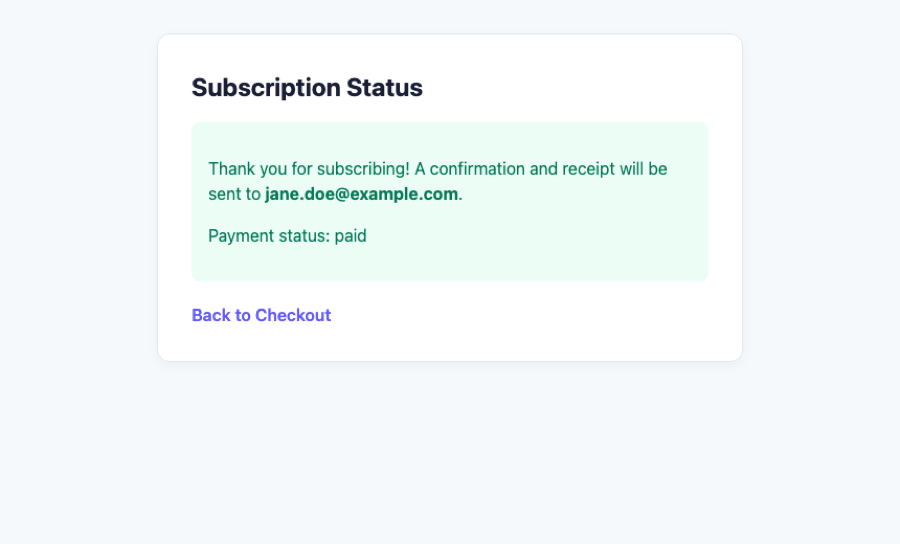

# Stripe Embedded Checkout Developer Guide

This guide walks through how this sample application builds a **Stripe Embedded Checkout** subscription page in Node.js and Express, how payer email collection and verification work end to end, and what is required to move from Stripe Sandbox to production.

---

## 1. Architecture Overview

The integration uses a three-endpoint Express server (`GET /config`, `POST /create-checkout-session`, `GET /session-status`) paired with two static pages (`public/index.html` and `public/return.html`).



---

## 2. Step-by-Step Development Guide

### Step 1: Configure Stripe Sandbox & Minimum-Privilege Restricted Key

1. Open your **Stripe Sandbox (Test Mode)** dashboard.
2. Create a **Product** with a recurring **Price** (for example, monthly USD billing) and make sure it is set as the product's **Default price**. Copy the `prod_...` ID.
3. Obtain your **Publishable key** (`pk_test_...`) from **Developers → API keys**.
4. Create a **Restricted key** (`rk_test_...`) following the principle of least privilege:

| Resource | Permission | Why It Is Needed |
| --- | --- | --- |
| **Checkout Sessions** | `Write` | Create embedded checkout sessions (`POST /v1/checkout/sessions`) and retrieve/expire sessions (`GET /v1/checkout/sessions/:id`) |
| **Products** | `Read` | Retrieve the configured product (`GET /v1/products/:id`) to resolve its `name` and `default_price` |
| **Prices** | `Read` | Expand or retrieve the recurring price (`unit_amount`, `currency`, `recurring.interval`) for display and fallback resolution |
| **Subscriptions** | `Read` *(optional)* | Needed only if your backend or test harness calls `stripe.subscriptions.retrieve(subId)` directly |

5. Copy `.env.example` to `.env` and populate your Sandbox credentials:

```env
STRIPE_SECRET_KEY=rk_test_replace_me
STRIPE_PUBLISHABLE_KEY=pk_test_replace_me
STRIPE_PRODUCT_ID=prod_replace_me
# Optional fallback if the product has no default_price configured:
# STRIPE_PRICE_ID=price_replace_me
PORT=4242
BASE_URL=http://localhost:4242
```

---

### Step 2: Implement the Express Server Endpoints (`server.js`)

#### Startup Sandbox Guard & Plan Resolution

At startup, `validateSandboxConfig()` verifies that `STRIPE_SECRET_KEY` starts with `rk_test_` or `sk_test_` and `STRIPE_PUBLISHABLE_KEY` starts with `pk_test_`. If someone accidentally configures a live key (`sk_live_...`, `rk_live_...`, or `pk_live_...`), the process exits immediately with status code `1`.

Next, `resolvePlanInfo()` calls `stripe.products.retrieve(PRODUCT_ID, { expand: ['default_price'] })` to cache:
- `priceId` (`price_...`) for creating Checkout Sessions
- `productName` and formatted `displayPrice` (derived from `unit_amount`, `currency`, and `recurring.interval`) for the UI

#### `GET /config`

Returns the publishable key and resolved plan metadata so the frontend never hardcodes account-specific product names or prices:

```json
{
  "publishableKey": "pk_test_replace_me",
  "productName": "Example Plan",
  "displayPrice": "$29.99 / month",
  "unitAmount": 2999,
  "currency": "usd",
  "interval": "month"
}
```

#### `POST /create-checkout-session`

Validates the submitted email address and creates a Checkout Session in subscription mode:

```js
const session = await stripe.checkout.sessions.create({
  ui_mode: 'embedded_page',
  mode: 'subscription',
  customer_email: email,
  line_items: [{ price: resolvedPriceId, quantity: 1 }],
  return_url: `${BASE_URL}/return.html?session_id={CHECKOUT_SESSION_ID}`,
});
```

> [!IMPORTANT]
> **`ui_mode: 'embedded_page'` vs `'embedded'`:**
> In `stripe` Node SDK v23+ (Stripe API version `2026-09-30.endive`), Stripe renamed the parameter value from `'embedded'` to `'embedded_page'`. If you use an older SDK/API version (such as `2024-06-20`), pass `ui_mode: 'embedded'` instead.

Note the literal `{CHECKOUT_SESSION_ID}` template token in `return_url`—Stripe replaces it with the actual `cs_test_...` session ID when redirecting the buyer after payment completion.

#### `GET /session-status`

Retrieves the Checkout Session by `session_id` and extracts the payer's email via `session.customer_details?.email ?? session.customer_email`:

```js
const session = await stripe.checkout.sessions.retrieve(sessionId.trim());
const customerEmail = session.customer_details?.email ?? session.customer_email ?? null;
```

When `session.status === 'complete'`, the server logs the completed checkout line:

```text
[Checkout Complete] session_id=cs_test_... customer_email=jane.doe@example.com subscription_id=sub_...
```

---

### Step 3: Mount Embedded Checkout on the Frontend (`public/index.html` & `public/checkout.js`)

1. Load `https://js.stripe.com/v3/` in `public/index.html`.
2. On page load, `public/checkout.js` calls `GET /config` to render the plan title (`Subscribe to <productName>`, falling back to `Subscribe`) and recurring price (`$29.99 / month`).
3. The buyer enters their email address (`jane.doe@example.com`) and clicks **Continue to Checkout**:



4. On form submission, `checkout.js` requests a `clientSecret` from `POST /create-checkout-session`, initializes Embedded Checkout with `stripe.initEmbeddedCheckout({ fetchClientSecret })`, hides the email form, and mounts the Stripe iframe into `#checkout`:



---

### Step 4: Verify Session Status on the Return Page (`public/return.html` & `public/return.js`)

After payment succeeds, Stripe redirects the browser to `/return.html?session_id=cs_test_...`. `public/return.js` reads `session_id` from `window.location.search` and calls `GET /session-status`:

- If `status === 'open'`, the buyer has not finished paying and is redirected back to `/`.
- If `status === 'complete'`, the page displays the payer's confirmed email address (`#customer-email`) and payment status (`#payment-status`):



---

### Step 5: Test Cards & Automated Tests

Use the following Stripe Sandbox test cards with any future expiration date (e.g. `12/34`), any 3-digit CVC (`123`), and a valid billing postal code (e.g. `94103`):

| Test Case | Card Number | Expected Behavior |
| --- | --- | --- |
| Standard Visa success | `4242 4242 4242 4242` | Payment succeeds immediately and redirects to `/return.html` |
| 3D Secure (3DS) challenge | `4000 0025 0000 3155` | Opens a 3DS challenge modal inside the checkout frame; click **Complete authentication** to finish |
| Generic decline | `4000 0000 0000 0002` | Displays an inline card declined error inside Embedded Checkout |

Run the automated integration test suite at any time:

```bash
npm test
```

The test suite (`test/server.test.js`) starts the server on an ephemeral port, verifies static HTML routes, checks `GET /config`, validates `400` responses on bad input, creates a real Sandbox Checkout Session via `POST /create-checkout-session`, verifies `GET /session-status`, tests the sandbox key guard against live key prefixes, and expires created test sessions during teardown.

---

## 3. Moving from Testing to Production Checklist

Before accepting real payments, complete every item below:

- [ ] **1. Activate your Stripe account:** Complete business verification, bank payout details, and statement descriptor configuration in the Stripe Dashboard.
- [ ] **2. Provision live keys via a Secrets Manager:** Create a live Publishable key (`pk_live_...`) and a minimum-privilege live Restricted key (`rk_live_...`). Store `STRIPE_SECRET_KEY` and `STRIPE_WEBHOOK_SECRET` in your platform's secrets manager (AWS Secrets Manager, GCP Secret Manager, Vault, etc.)—never in source control or container images.
- [ ] **3. Recreate Products and Prices in Live Mode:** Sandbox `prod_...` and `price_...` IDs do not exist in live mode. Copy your product to Live Mode (or recreate it) and update `STRIPE_PRODUCT_ID` / `STRIPE_PRICE_ID` with the live IDs.
- [ ] **4. Gate the Sandbox Guard with an explicit environment flag:** Do **not** simply delete `validateSandboxConfig()`. Instead, require an explicit environment variable such as `STRIPE_ENV=live` (defaulting to `sandbox`) and assert that `STRIPE_ENV=sandbox` only accepts `*_test_*` keys while `STRIPE_ENV=live` only accepts `rk_live_` / `pk_live_` keys. This prevents accidental cross-mode misconfiguration:
  ```js
  const STRIPE_ENV = process.env.STRIPE_ENV || 'sandbox';
  if (STRIPE_ENV === 'live') {
    if (!SECRET_KEY.startsWith('rk_live_')) {
      console.error('Fatal: STRIPE_ENV=live requires a restricted live key (rk_live_...).');
      process.exit(1);
    }
    if (!PUBLISHABLE_KEY.startsWith('pk_live_')) {
      console.error('Fatal: STRIPE_ENV=live requires a live publishable key (pk_live_...).');
      process.exit(1);
    }
  } else {
    validateSandboxConfig();
  }
  ```
- [ ] **5. Enforce HTTPS and set a production `BASE_URL`:** Stripe Live Mode requires `https://` for `return_url` and pages mounting Stripe.js. Configure TLS termination and set `BASE_URL=https://billing.yourdomain.com`.
- [ ] **6. Implement a signed Stripe Webhook endpoint (`whsec_...`) as the source of truth:**
  - The browser redirect to `/return.html` is **not authoritative**—a buyer may close their browser tab immediately after paying, or lose connectivity before the redirect completes.
  - Register `POST /webhook` **before** `app.use(express.json())` using `express.raw({ type: 'application/json' })` and verify the `Stripe-Signature` header with `stripe.webhooks.constructEvent(req.body, sig, process.env.STRIPE_WEBHOOK_SECRET)`:
  ```js
  app.post('/webhook', express.raw({ type: 'application/json' }), async (req, res) => {
    const sig = req.headers['stripe-signature'];
    let event;
    try {
      event = stripe.webhooks.constructEvent(
        req.body,
        sig,
        process.env.STRIPE_WEBHOOK_SECRET
      );
    } catch (err) {
      return res.status(400).send(`Webhook Error: ${err.message}`);
    }

    // Idempotency guard: skip if event.id was already processed
    if (await db.hasProcessedStripeEvent(event.id)) {
      return res.status(200).json({ received: true, duplicate: true });
    }

    if (event.type === 'checkout.session.completed') {
      const session = event.data.object;
      const email = session.customer_details?.email ?? session.customer_email;
      await db.provisionSubscription({
        eventId: event.id,
        sessionId: session.id,
        customerId: session.customer,
        subscriptionId: session.subscription,
        email,
      });
    }
    res.status(200).json({ received: true });
  });
  ```
  - Handle at least:
    - `checkout.session.completed` (provision subscription access and record `session.customer_details.email`, `session.customer`, and `session.subscription`)
    - `invoice.paid` (extend subscription billing period on renewals)
    - `invoice.payment_failed` (notify customer / enter grace period)
    - `customer.subscription.updated` and `customer.subscription.deleted` (sync plan changes and cancellations)
- [ ] **7. Make webhook fulfillment idempotent:** Record processed Stripe `event.id` values in your database with a unique constraint so webhook retries never provision duplicate accounts or send duplicate emails.
- [ ] **8. Persist customers and subscriptions in a database:** Replace `console.log('[Checkout Complete] ...')` with durable database writes linking your internal user record to `stripe_customer_id`, `stripe_subscription_id`, `customer_email`, and subscription status.
- [ ] **9. Protect PII & comply with privacy regulations (GDPR / CCPA):** Treat `customer_email` and billing details as Personally Identifiable Information (PII). Avoid logging raw emails in unredacted application logs, encrypt backups, and support data deletion requests.
- [ ] **10. Enable the Stripe Customer Portal for self-serve cancellations:** Configure the Stripe Customer Portal so subscribers can update payment methods, download invoices, and cancel subscriptions without manual support intervention.
- [ ] **11. Configure Tax & Receipts:** Enable **Stripe Tax** (`automatic_tax: { enabled: true }`) if applicable in your jurisdictions, and enable automatic customer email receipts and invoice emails in Stripe Dashboard → **Settings → Emails**.
- [ ] **12. Configure Content Security Policy (CSP) headers:** Allow `https://js.stripe.com` in `script-src` and `frame-src`, and `https://api.stripe.com` in `connect-src`.
- [ ] **13. Add rate limiting & bot protection:** Add IP/session rate limiting (e.g. `express-rate-limit`) on `POST /create-checkout-session` and `GET /session-status` to prevent session creation spam or enumeration.
- [ ] **14. Set up monitoring & alerting:** Alert on Stripe webhook delivery failures, `403` permission errors (`[STRIPE PERMISSION ERROR]`), and elevated `5xx` responses.
- [ ] **15. Run a live smoke test and verify rollback:** Complete a real subscription using a live card (or a 100%-off live coupon / low-value test tier), verify webhook provisioning and Customer Portal access, refund and cancel the test subscription, and document your rollback procedure (`STRIPE_ENV` + previous release image).

---

## 4. Secret Hygiene

1. **Keep `.env` out of Git:** `.env` is listed in `.gitignore`. Only `.env.example` (containing safe placeholders like `rk_test_replace_me` and `prod_replace_me`) is tracked.
2. **Run the secret scanner before every commit:**
   ```bash
   npm run check-secrets
   ```
   `scripts/check-secrets.sh` scans all files that Git tracks or would track (`git ls-files -co --exclude-standard`) for Stripe secret/restricted/publishable/webhook keys (`sk_live_`, `sk_test_`, `rk_live_`, `rk_test_`, `pk_live_`, `pk_test_`, `whsec_` followed by 20+ alphanumeric characters) and real-looking Stripe object IDs (`acct_`, `prod_`, `price_`, `sub_`, `cs_test_`, `cs_live_` followed by 10+ alphanumeric characters). It exits non-zero if any match is found.
3. **Rotate immediately on leak:** If a secret or restricted key is ever committed or exposed in logs, immediately roll/revoke the key in **Stripe Dashboard → Developers → API keys** and audit recent API request logs.
